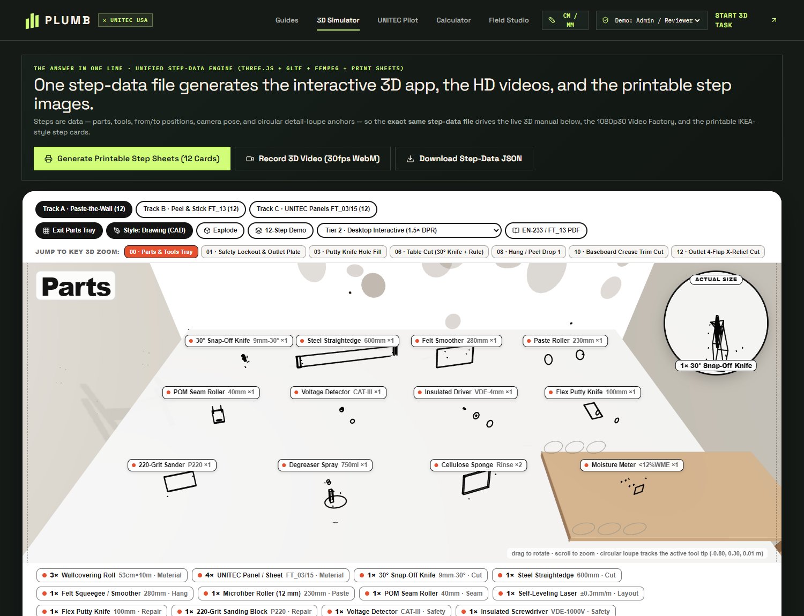
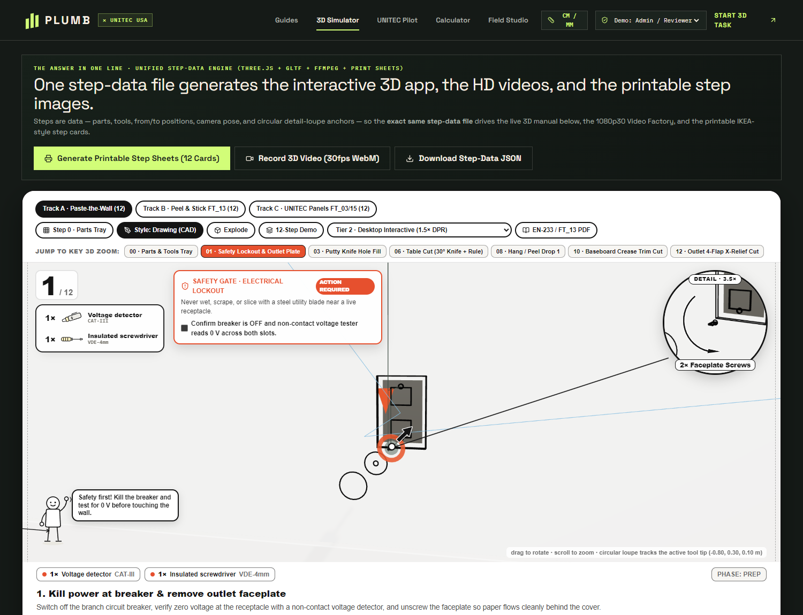
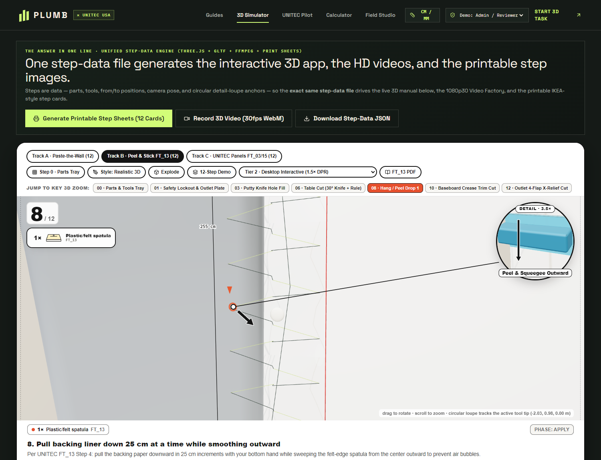
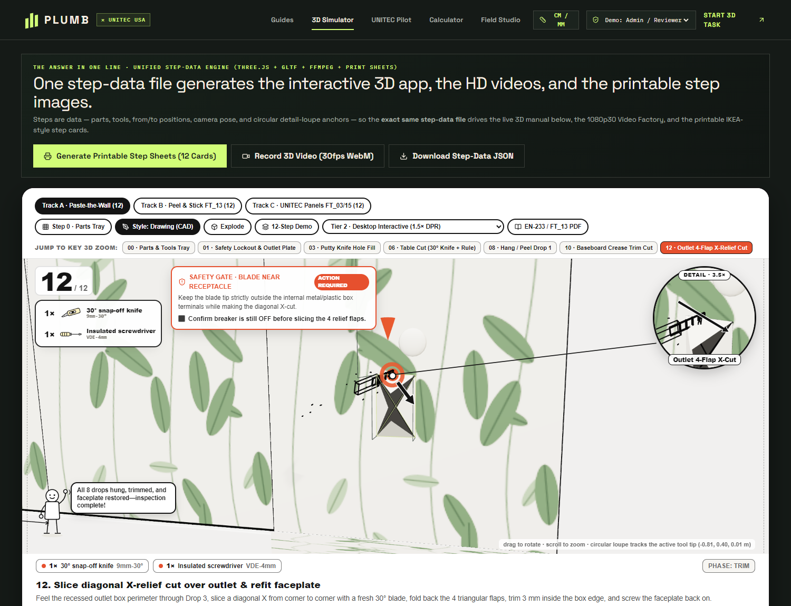

# PLUMB — Interactive 2D/3D Installation Training

A React, TypeScript and Three.js repository for evidence-linked wallcovering demonstrations and UNITEC visual-training prototypes.

## Current release: 14-step paste-the-wall lesson

Open `/guides/paste-the-wall` (also available at `/training/wallpaper`). The existing home-page **2D/3D Field Guide** action reaches this lesson.

The module in `src/wallpaper/` provides:

- A complete sequence from product verification and electrical safety through preparation, layout, plumb, measurement, paste application, dry-drop hanging, smoothing, trimming, pattern matching, outlet work, cleaning and final inspection.
- One instructional contract driving the Three.js scene, operation-specific SVG drawings, accept/recheck comparisons, scenario decisions, playback, global timeline and A4 field sheet.
- Play/pause, reverse playback/pause, previous/next, speed control, timeline scrubbing, camera orbit/zoom/reset and room/front views.
- A real training gate: later wet-work and installation steps cannot be entered by playback, step navigation or scrubbing until electrical safety is acknowledged. The acknowledgement does not isolate power.
- Step-specific tools, materials, reasons, warnings, inspection checks and evidence links.
- Fourteen scenario decisions with retries and corrective feedback, plus paired reconstructed **Accept when / Stop + recheck** visuals. These are session-only learning checks, not persisted learner records, competency assessment or site sign-off.
- Explicit labels separating manufacturer general guidance, adhesive-manufacturer guidance and reconstructed demonstration geometry.
- Route-level lazy loading so the wallpaper lesson and Three.js payload are not requested by the home-page initial load.

**Approval boundary:** this is general teaching guidance with reconstructed graphics, not manufacturer-approved training for a specified roll or adhesive. Confirm the actual roll label, adhesive datasheet, site risk assessment and electrical requirements before work. The supplied Kami viewer requires sign-in and its document has not been reviewed; no instruction is attributed to it.

## Repository reality and capability boundaries

This GitHub repository is currently a **frontend-only React/Vite application**.

- It does not contain the Hono, Drizzle, MySQL or real authentication backend used by the separate local full-stack prototype.
- `src/lib/trpc.ts` is a browser-local demo adapter, not tRPC or server persistence.
- Browser `localStorage` profiles, uploads and review states are demonstrations only. They do not synchronize across devices and are not a production moderation or asset-storage system.
- Scenario answers in the new wallpaper lesson are React session state and are not presented as backend progress records.
- The new wallpaper module has scene-matched browser printing. It is **not yet connected to deterministic HD video export**.
- Earlier simulator/video code and screenshots are prototypes, not proof of a unified verified 1080p production pipeline for every guide.
- `contracts/blueprintData.ts`, `contracts/tasks/wallpaperTask.ts` and `src/wallpaper/guide.ts` are separate authorities for different prototypes. Do not treat them as one synchronized data source.
- A realistic render does not establish manufacturer installation approval.

## Routes

| Route | Purpose |
| --- | --- |
| `/` | Guide library and entry points |
| `/guides/paste-the-wall` | Evidence-linked 14-step lesson |
| `/training/wallpaper` | Alias for the lesson |
| `/simulator` | Earlier granular task simulator prototype |
| `/guides/:slug` | Earlier shared guide player |
| `/materials` | Three-product UNITEC visual-fidelity pilot |
| `/calculator` | Wallpaper and panel estimation prototypes |
| `/studio` | Browser-local contribution/review demonstration |

For static hosting without SPA rewrites, enter through `/` and use in-app navigation.

## Architecture

```text
contracts/
  blueprintData.ts             Earlier CAD guide data
  tasks/wallpaperTask.ts       Earlier granular simulator task data
  guides/                      Earlier shared and UNITEC guide data
src/
  wallpaper/
    guide.ts                   Instruction, evidence, gate and learning-check contract
    WallpaperScene.ts          Deterministic operation-specific Three.js choreography
    ReferenceDrawing.tsx       Reconstructed per-step SVG figures
    QualityComparison.tsx      Paired accept/recheck visual examples
    LearningCheck.tsx          Scenario choices, retries and corrective feedback
    WallpaperTrainingPage.tsx  Timeline, playback, evidence and print interface
    wallpaper.css              Responsive technical workspace and A4 layout
  scene/                       Earlier CAD/PBR scene experiments
  pages/                       Earlier route-level prototypes
tests/
  wallpaper-guide-v3.test.ts   Instructional, learning-check and provenance tests
  wallpaper-task.test.ts       Earlier simulator/toolpath tests
  guides-and-calculator.test.ts Earlier guide/calculator tests
```

### New-module contract

Every new step has a stable ID, phase, full and short title, instruction, reason, tools, materials, inspection check, accept/recheck criteria, scenario checkpoint, operation, animation duration and evidence IDs. `canAccessStep()` is the electrical-gate authority. `seek(stepIndex, progress, operation)` reconstructs scene state deterministically rather than accumulating unrelated animations.

The complete timeline is 111 seconds. This is animation time, not estimated installation time. The same guide data supplies the interactive checks and the answers printed on the field sheet; there is no separately maintained print sequence.

### Add a product-specific lesson

1. Obtain the current SKU-specific roll label, installation manual, adhesive datasheet, dimensions, pattern repeat/match, safety and cleaning documents, plus usage rights.
2. Record each source and its scope. Do not substitute generic instructions for missing product facts.
3. Author a separate method-specific contract. Paste-the-wall, paste-the-paper, pre-pasted, peel-and-stick and rigid panels must not share incorrect choreography.
4. Reconstruct geometry only where necessary and label it as reconstructed. Catalogue imagery is not manufacturing CAD or a complete PBR scan.
5. Link original manual pages to steps only when the document is accessible and reviewed.
6. Test instructional order, safety gates, evidence references, scenario recovery, forward/reverse playback, scrubbing, print and mobile behavior in the real browser.
7. Obtain editorial/client approval separately from manufacturer installation approval.

## Run locally

Requirements: Node.js 20+ and npm.

```bash
npm install
npm test
npm run build
npm run dev
```

`npm run build` performs TypeScript checking and the Vite production build. Do not change the build script to hide upstream failures.

## Verification status

The synchronized local full-stack prototype passed TypeScript checking, its 11-test combined suite and production build. The wallpaper contract accounts for seven of those tests, including valid scenario decisions and accept/recheck criteria for every step.

In that production environment, the lesson was cold-loaded directly at desktop and 390 px mobile widths. Every operation’s quality diagrams and all 14 scenario checks were exercised, including wrong-answer recovery and a 14/14 session score. Blocked navigation, electrical-gate release, forward play/pause, reverse playback/pause, accessible control names, duplicate-ID checks and the four-page A4 field sheet were verified. The field sheet contained all 14 decision checks. The mobile page had no horizontal overflow or undersized visible buttons. The home route did not request the wallpaper lesson or Three.js chunks. The final cold reload reported no application errors or failed requests, and the standalone server bundle started without installed dependencies.

Those results are not a claim that every earlier prototype path has the same verification status. Run this repository's complete test/build/browser release check after cloning or making changes. Browser checks also do not establish product approval, persisted learner progress or site-installation competence.

## Earlier CAD prototype gallery

These images document the earlier line-art prototype, not approval or verification of the new 14-step lesson.

| Parts/tools tray | Electrical safety prototype |
| :---: | :---: |
|  |  |

| Realistic material prototype | Outlet relief-cut prototype |
| :---: | :---: |
|  |  |

The earlier renderer explores `LineSegments2`, inverted-hull silhouettes, cel-shaded faces, SVG leader lines and detail loupes. Those techniques can be reused selectively, but they do not replace correct installation data or safety enforcement.

## Known limits and next work

- Connect an accessible product manual/PDF and original page references when supplied.
- Keep product-specific wallpaper methods and rigid-panel workflows separate.
- Replace or isolate browser-local demo authentication, moderation and uploads before presenting them as production features.
- Integrate deterministic HD export with the new scene only through the same timeline and verify codec, dimensions, frame rate, frame count and visual frames.
- UNITEC installation content still awaits complete SKU-specific manufacturer evidence and approval.

## Sources and references

See `CREDITS.md` for instructional sources, product imagery attribution and open-source references. Key architecture references include [Flat Pack](https://sael.net/flatpack/?ref=gunpla) and [Nutlope/bygga](https://github.com/Nutlope/bygga) (MIT). No code was copied from Flat Pack or Bygga into the new module.
