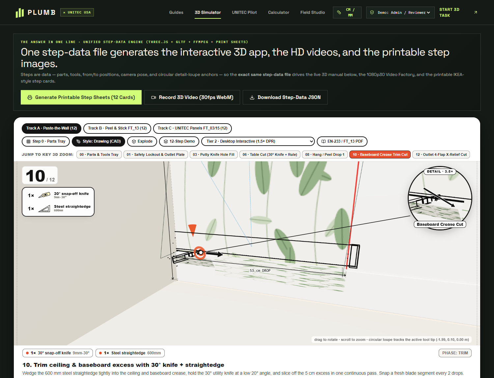

# PLUMB × UNITEC USA — Interactive 3D CAD Step-by-Step Manual Engine (`step-by-step-manual-2D`)

> **THE ANSWER IN ONE LINE:**
> *It's not a video OR a prompt OR pictures. One unified step-data file (`contracts/blueprintData.ts`) generates the interactive 3D app, the HD 1080p30 videos, and the printable step sheets.*



---

## 1. Visual Gallery (Hardware D3D11 WebGL Renders)

| Step 0 · 3D Parts & Tools Tray | Step 1 · Electrical Lockout Safety Gate |
| :---: | :---: |
|  |  |

| Step 8 · Track B Peel & Stick (`FT_13`) Realistic 3D | Step 12 · Outlet 4-Flap X-Relief Cut |
| :---: | :---: |
|  |  |

---

## 2. Open-Source 3D CAD Line-Art Shader Pipeline (`src/scene/lineArtMaterials.ts`)

Standard WebGL `THREE.LineBasicMaterial` is clamped to `1.0 px` on Windows D3D11/ANGLE and `THREE.EdgesGeometry` produces zero silhouette outlines on curved cylinders (paste rollers, spray bottles, wallpaper rolls, screwdriver handles).

Our engine solves this using a **3-Pass CAD Line-Art Shader Pipeline** adapted from MIT-licensed open-source reference projects ([`Nutlope/bygga`](https://github.com/Nutlope/bygga) and **Three.js official fat-line addons**):

1. **Pass 1 — 4-Band Discrete Cel/Toon Shader (`createFaceMaterial`)**:
   - Renders near-white paper faces (`#faf9f5`) with 4 discrete luminance bands and a warm active-part tint (`#fff3c4`) plus `polygonOffset` so ink lines never z-fight.
2. **Pass 2 — Inverted-Hull Screen-Space Silhouette Shader (`createHullMaterial`, `THREE.BackSide`)**:
   - Extrudes vertices outward in clip space along averaged `hullDir` normals (`clip.xy += dir * uWidth * 2.0 / uRes * clip.w`), wrapping every curved cylinder, roller, bottle, and bevelled `RoundedBoxGeometry` tool in a crisp `2px` outer ink contour.
3. **Pass 3 — Screen-Space Anti-Aliased Fat Crease Lines (`LineSegments2` + `LineMaterial`)**:
   - Renders `2.15px` ink creases on active tools/parts and `1.35px` muted creases (`#8a867e`) on background context.
4. **Screen-Space Vector SVG Callouts & 2D Tool Line-Art (`src/components/ManualLineArt.tsx`)**:
   - **Corner Hardware/Tool Box (`.bobby-hw-box`)**: Displays 2D vector line-art illustrations (`strokeWidth={1.8}`) and quantities (`1×`, `2×`) directly below the step number.
   - **Circular `DETAIL · 3.5×` Magnifying Loupe (`#inset`)**: Dedicated telephoto `24°` FOV macro pass locked onto the active 3D tool tip, connected via a tangent-circumference SVG leader line (`#leads`) and overlaid with vector action/rotation arrows (`arrowPath` & `arcArrow`).
   - **3D-Projected Architectural Dimension Lines (`dimensionLineSvg`)**: Live screen-space CAD dimension ticks (`53 cm DROP`, `255 cm`, `416 cm`).

---

## 3. Complete Blueprint Architecture (`/simulator`)

- **3 Complete 12-Step Tracks (+ 36 Granular Sub-Operations)**:
  - **Track A · Paste-the-Wall Wallpaper (`EN-233`)**
  - **Track B · Peel-and-Stick / UNITEC `FT_13` Self-Adhesive Marble Roll (`0.60 × 2.80 m`)**
  - **Track C · UNITEC `FT_03` PVC Marble Sheet & `FT_15` WPC Interior Panel with `FT_27` PEGATEC Adhesive**
- **Step 0 — 3D Parts & Tools Tray**: Lays out all 12 tools and materials in 3D with non-overlapping projected HTML part chips and an `ACTUAL SIZE` detail loupe.
- **Interactive Electrical Lockout Safety Gate**: Mandatory verification banner on electrical receptacle steps (`Step 1` and `Step 12`).
- **Live Roll & Pattern Calculator + "Don't Guess" Conflict Matrix**: Side-by-side comparison of **Formula A (Pro Strip-by-Strip with pattern repeat rounding)** vs. **Formula B (Area + Waste % approximation)** across `52 cm`, `53 cm`, and `60 cm` (`FT_13`) widths, plus a side-by-side table of industry source conflicts (roll widths, paint cure times, adhesive cure times).
- **One-Data-File Outputs**:
  - **Printable Step Sheets Generator**: Steps deterministically through all 12 steps in `Drawing (CAD)` mode and composites each card with its circular `3.5×` detail loupe for `window.print()`.
  - **HD Video Factory**: 4 capture pipelines (Deterministic Headless Frame-by-Frame PNG → FFmpeg `1080p30`, WebCodecs `canvas-record`, in-browser `30 fps` `MediaRecorder` WebM stream, and Printable Sheet renderer).
  - **Contribution / Moderation System**: Transition guides through `Draft → Review → Approved` alongside the **6-Phase Build Plan** and **Copy-Ready Master Developer Prompt**.

---

## 4. Open-Source Stack & References

- **[`Nutlope/bygga`](https://github.com/Nutlope/bygga) (MIT)** — Open-source 3D manual generator (`LineSegments2` + `BackSide` hull silhouette shader + 4-band cel shader + vector `ToolArt`/`Figure`).
- **[`loloop00/3D-IKEA-instructions`](https://github.com/loloop00/3D-IKEA-instructions)** — Dual-viewport circular `#inset` close-up loupe + `#leads` SVG leader line pattern.
- **[`gkjohnson/three-edge-projection`](https://github.com/gkjohnson/three-edge-projection) & [`three-mesh-bvh`](https://github.com/gkjohnson/three-mesh-bvh) (MIT)** — Silhouette/crease projection & hidden-line removal for CAD technical illustrations.
- **[`OmarShehata/webgl-outlines`](https://github.com/OmarShehata/webgl-outlines) (MIT)** — Screen-space normal/depth/surface-ID edge detection in Three.js.
- **[`mrdoob/three.js`](https://github.com/mrdoob/three.js/) (MIT)** — Core 3D WebGL engine, `LineSegments2`, `LineMaterial`, and `RoundedBoxGeometry`.

---

## 5. Quick Start

```bash
npm install
npm test
npm run build
npm run dev
```
